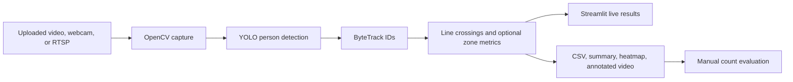

# QueueWatch — Real-Time People Flow Analytics

QueueWatch analyzes a local video, detects people, assigns temporary track IDs, and counts crossings in both directions across a user-positioned finite line. The crossing point is the bottom-center of each detection box. An optional rectangular zone reports visitor entries, approximate dwell time, peak occupancy, and a footfall heatmap. It also exports individual crossing events and frame-level person counts for evaluation against manual annotations.

## Run

```powershell
py -m venv .venv
.venv\Scripts\Activate.ps1
python -m pip install -r requirements.txt
streamlit run app.py
```

On the first run, Ultralytics downloads the small `yolo11n.pt` weights. Processing runs locally after that. Upload a short MP4/MOV/AVI clip, choose the crossing line and editable direction labels (default **Entered** / **Exited**), and select **Analyze video**. Use a short clip first; CPU processing can take longer than the clip duration. The annotated output is encoded to H.264 with FFmpeg when available; if that encoder is unavailable, the app keeps a downloadable MP4 fallback and reports its browser compatibility.

For a live source, select **Webcam** or **RTSP stream**, provide the device index or masked RTSP URL, set a finite capture duration, and start live analysis. The live preview updates as frames are processed. Live streams do not create an annotated recording.

The same processing pipeline has a command-line entry point:

```powershell
python src/cli.py path\to\clip.mp4 --line 0.02 0.5 0.98 0.5
```

It writes an annotated MP4, per-frame counts, individual crossing events, and a JSON summary into `output/`. Add `--zone 0.35 0.35 0.70 0.90` to report the optional zone visitor/dwell summary and save a footfall heatmap.

## Evaluation

Create a ground-truth CSV with columns `frame,people_in_frame`, manually count the people visible in selected frame numbers, then compare it with the exported predictions:

```powershell
python src/evaluate_counts.py queuewatch-frame-counts.csv evaluation/my_manual_counts.csv
```

The script reports mean absolute error (people per frame) and symmetric mean absolute percentage error. Use clips and frames that reflect the camera angle, lighting, crowd density, and motion expected in the intended setting. The app also reports measured processing FPS so CPU performance can be compared on the same clip and hardware.

The repository includes an 8-second synthetic silhouette clip and manual counts. Reproduce its evaluation with:

```powershell
python src/cli.py evaluation/sample_demo.mp4 --output-dir output/sample-demo --no-video
python src/evaluate_counts.py output/sample-demo/frame_counts.csv evaluation/sample_manual_counts.csv --summary output/sample-demo/summary.json
```

Measured on the bundled 80-frame clip at confidence 0.10:

| Measure | Result |
| --- | ---: |
| MAE | 0.425 people/frame |
| sMAPE | 85.00% |
| Processing speed | 6.63 frames/second |

The clip is a simple cartoon silhouette rather than representative camera footage. The high percentage error is a useful limitation to show: these numbers do not establish accuracy on real people or customer sites. FPS varies with hardware.

Run the unit tests with `python -m unittest discover -s tests -v`.

## Design and limitations

- YOLO person detections are associated over time with ByteTrack; a crossing event is logged when the tracked foot point crosses the configured finite line segment. Direction labels follow the signed sides defined by the endpoint order. A short per-track debounce suppresses jitter duplicates.
- Optional zone dwell uses tracked foot points and a one-second grace period for brief detection gaps. Dwell values are approximate and can be understated when IDs switch or people are occluded.
- The model may miss or merge people during occlusion, and IDs can switch. Camera placement and line position affect counts.
- This prototype does not recognize faces and does not store the uploaded clip. The annotated video is only created when selected and is offered as a download.
- Do not use counts as a safety-critical occupancy estimate without site-specific validation.

## Architecture


